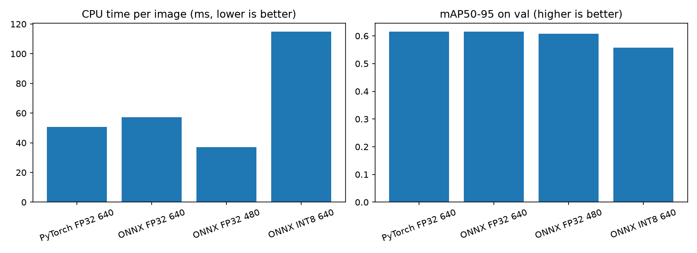
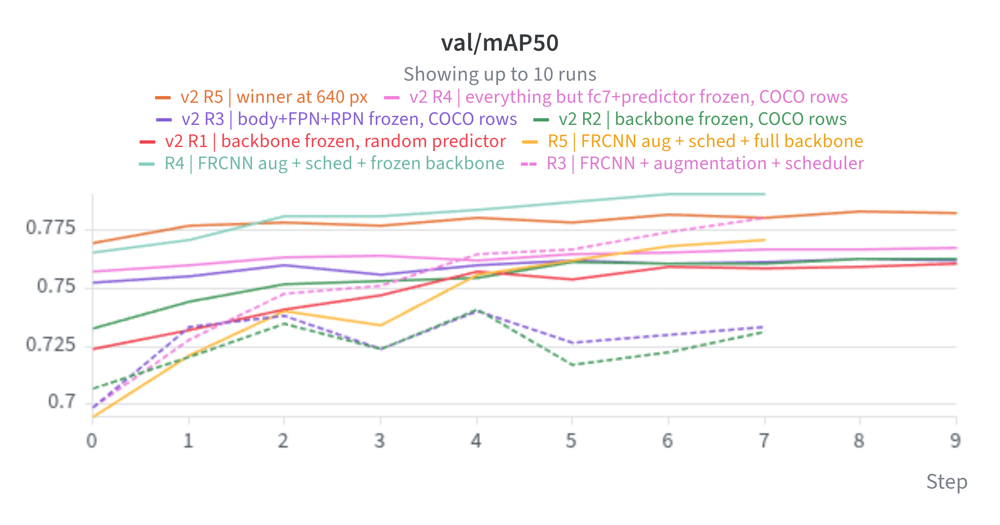
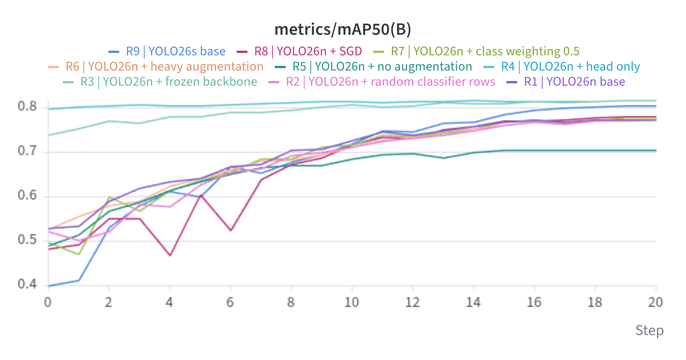
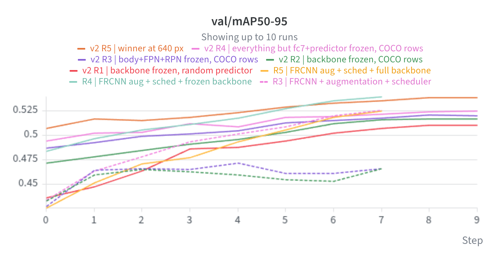
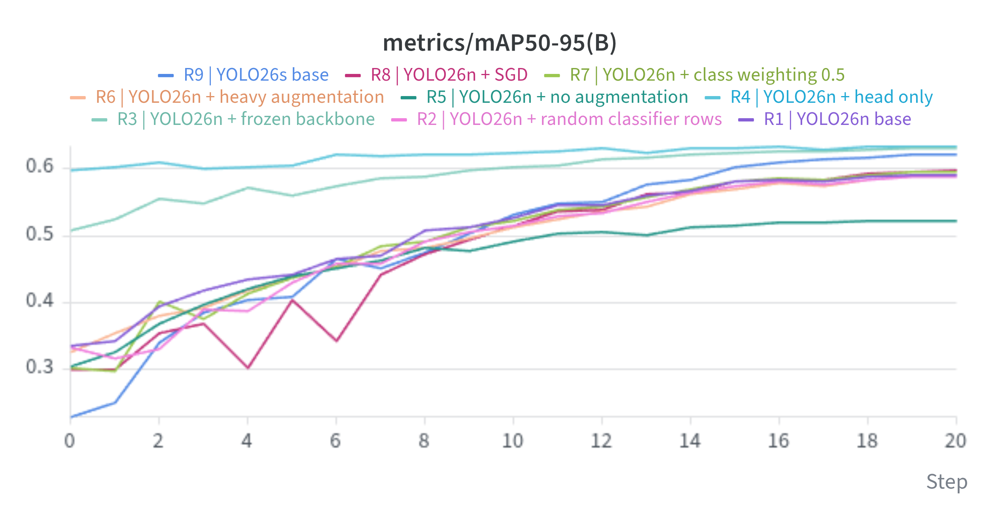

# ობიექტების დეტექცია YOLO26 - ის მეშვეობით

პროექტის მიზანია გამოსახულებებზე აღმოაჩინოს და მონიშნოს არსებული კლასებიდან ნებისმიერი(person, car, dog, chair, …). 

  პროექტის მიმდევრობა:

1. მონაცემების დამუშავება (Parsing)
2. ორი მოდელის finetuning
3. ექსპერიმენტების მართვა
4. შეფასება
5. ოპტიმიზაცია
6. მოდელის გაშვება

## 1. Demo

იმისათვის, რომ დემოს გაშვება შეძლოთ გადმოწერეთ Docker

```bash
cd api
docker build -t voc-detector .
docker run --rm -p 8000:8000 voc-detector
```

გატესტვა შეგიძლიათ ორნაირად:

- **ინტერაქციული დემო:** გახსენით http://localhost:8000/docs, აირჩიეთ `POST /predict` → *Try it out*, ატვირთეთ სურათი, შემდეგ *Execute*.
- **ტერმინალიდან:**
  ```bash
  curl http://localhost:8000/health
  curl -D - -F "file=@/PATH/TO/photo.jpg" http://localhost:8000/predict -o out.png          # სურათი ჩარჩოებით
  curl -F "file=@PATH/TO/photo.jpg" "http://localhost:8000/predict/json?conf=0.5"          # ჩარჩოები JSON-ად
  ```
- ფოტოს, რომელსაც გადასცმემთ უნდა მოიცავდეს მინიმუმ ერთ ობიექტს შემდეგიდან: თვითმფრინავი,ველოსიპედი,ჩიტი,ნავი,ბოთლი,ავტობუსი,მანქანა,კატა,სკამი,ძროხა,სასადილო მაგიდა, ძაღლი, ცხენი,მოტოციკლი,ადამიანი, მცენარე, ტახტი,მატარებელი,ტელევიზორი

#### თუ ფოტოზე ცხადად არ არის გამოკვეთილი გამოსახულება, conf ის არგუმენტი გადაეცით უფრო დაბალი - `?conf=` endpoint-ის შემდეგ

| Endpoint | აბრუნებს |
|---|---|
| `GET /health` | სერვისის სტატუსი, მოდელის ფაილი, input ზომა, კლასების რაოდენობა |
| `POST /predict` | აბრუნებს იგივე ფოტოს, რომელზეც ნაპოვნი გამოსახულებები შემოფარგლულია, კლასის სახელით და confidence score-ით |
| `POST /predict/json` | `{"image_size", "time_ms", "detections": [{"label", "confidence", "box": [x1, y1, x2, y2]}]}` |

**Docker-ის გარეშე:** `pip install -r requirements.txt`, შემდეგ `api/` ფოლდერიდან `uvicorn main:app --host 0.0.0.0 --port 8000`.

## 2. რეპოზიტორიის სტრუქტურა

```
├── experiments/
│   ├── model_experiment_yolo26.ipynb            # YOLO26
│   ├── model_experiment_frcnn.ipynb             # FasterRCNN on kaggle, no use of caching - slow
│   └── model_experiment_frcnn_colab.ipynb       # FasterRCNN on Colab , ქეშირებით.
├── scripts/
│   ├── model_quantize.py     # VOC XML -> YOLO ლეიბლები + 80/20 დაყოფა + data.yaml
│   └── benchmark_model.py             # ONNX მოდელების შედარება - სიზუსტე / სიჩქარე / ზომა
├── api/
│   ├── main.py                        # FastAPI: letterbox -> ONNX Runtime -> postprocess -> bb draw
│   ├── best_fp32_480.onnx             # გაშვებული მოდელი
│   ├── requirements.txt               # მხოლოდ სერვისის დამოკიდებულებები (PyTorch-ის გარეშე)
│   ├── Dockerfile
│   └── .dockerignore
├── models/
│   ├── best_fp32_640.onnx
│   ├── best_int8_640.onnx
│   └── best.pt 
├── images/
│   ├── results.csv    
│   ├── results.csv 
│   ├── results.csv                 
│   ├── results.csv 
│   └── comparison.png  # ოპტიმიზირებული მოდელების შედარება
└── README.md
```

## 3. მონაცემები

- **მონაცემთა ნაკრები:** Pascal VOC 2012 ([Kaggle](https://www.kaggle.com/datasets/gopalbhattrai/pascal-voc-2012-dataset)), 20 კლასი.
- **გამოყენებული სურათები:** 11,540 სურათი (`ImageSets/Main/trainval.txt`). დანარჩენი სურათები სხვა ამოცანაზე არის გათვლილი.
- **split:** ყველა მოდელისთვის იდენტური:
  ```
  trainval.txt → sort → random.Random(42)-ით არევა → პირველი 80% train, 20% val
  ```
  შედეგი: **9,232 train / 2,308 val**.
- **Test set არ გვაქვს:** ოფიციალური ტესტ სეტი საჯარო ლეიბლებით არ არსებობს, ამასთან ერთად კეგლზე არსებული ტესტ სეტიც არ მიესადაგება ამ ამოცანის პირობას. ამის გამო ტესტ სეტი არ გამომიყენებია და შევაფასე მხოლოდ ვალიდაციის სეტზე, რომელიც მოდელს ტრენინგის დროს არ უნახავს. 

- **ლეიბლები:**
  - ორიგინალი მონაცამების ანოტაციები შენახული იყო XML ფორმატში, რაც მიუღებელია YOLO-სთვის
  - XML გადავიყვანე YOLO ფორმატში Labelformat-ით; შემოწმდა bounding box-ების დახატვით / კლასების შედარებით ფოტოებზე.
  - საწყის მონაცემებში გვაქვს "Difficult" ობიექტები, რომლებზეც ობიექტების აღმოჩენა უფრო რთული არის, VOC მსგავს ობიექტებს ევალუაციის დროს არ უყურებდა, ჩემს შემთხვევაში მსგავსი ობიექტები შენარჩუნებულია და შესაბამისად ტრენინგი უფრო მკაცრი არის.
- **დაუბალანსებელი დატა:** person კლასი დომინირებს სხვა კლასებთან შედარებით, ჩანაფიქრი იყო, რომ stratified სპლიტი გამეკეთებინა, მაგრამ ვინაიდან multilabel დეტექცია არის გადავიფიქრე და შევჯერდი რენდომ სპლიტზე. train და valid სეტები მეტნაკლებად ერთნაირად არიან განაწილებული, რაც ამ ეტაპზე დამაკმაყოფილებელი იყო.


## 4. მოდელის გაწვრნა

### YOLO26n (Ultralytics), მთავარი მოდელი

Notebook `notebooks/yolo26_voc.ipynb`.

ყველა გაშვება ილოგება W&B პროექტში `voc-yolo26`.

| პარამეტრი | მნიშვნელობა | 
|---|---|
| მოდელი | YOLO26n, Pretrained on COCO |
| Epochs / batch / imgsz | 20 / 32 / 640 | 
| Optimizer | AdamW, lr0 = 0.001, scheduler არ არის მითითებული, მაგრამ yolo თავისით იყენებს წრფივ კლებას, ყოველ ეპოქაზე | 
| Warmup / close_mosaic / patience | 1 epoch ( ფაინტუნინგის დროს, სასურველია სანამ საწყისი lr -ით დავიწყებთ, მოდელი "გავახუროთ", რათა სტაბილური გრადიენტები მივიღოთ) / 3 (ბოლო სამი ეპოქა, მოდელი აღარ იღებს მოზაიკისებრ ფოტოებს) / 10 ( რამდენი ეპოქის შემდეგ შეიძლება მოდელი ტრენინგს მორჩეს თუ loss არ იკლებს)    | 
| კლასიფიკატორის ინიციალიზაცია | COCO-ს კლასებსა და VOC-ის კლასებს შორის არის აცდენა ( არ ემთხვევა სახელები და კლასის ნომრები), `cls_remap` და ალიასების გამოყენება,გვეხმარება ამ პრობლემის გადაჭრაში|

### Faster R-CNN, MobileNetV3-Large-FPN (torchvision)

განსხვავებით YOLO-სგან, ამ მოდელს ჭირდება ტრენინგ ლუპი, როგორც ნებისმიერ pytorch-ის მოდელს.
- **v1 (Kaggle)** ზედმეტად ნელი იყო (~10.8 წთ train + 1.4 წთ val თითო epoch-ზე).
- **v2 (Colab)** ხელახლა დაიწერა ასაჩქარებლად:
  - ფოტოს ზომები შეიცვალა ( 800 -> 512 )
  - მთლიან მოდელს არცერთ ექსპერიმენტზე არ ვატრენინგებ
  - random გენერირებულ კლასიფიკატორს არ ვიყენებ
  - warmup + cosine LR
  - ქეშირება
  - ფოტოების აუგმენტაცია GPU-ზე
  - `pin_memory` / `persistent_workers` ( ესენიც ასაჩქარებლად)
 
- W&B პროექტი `voc-frcnn`.

## 5. ექსპერიმენტები და შედეგები

**მიდგომა:** ყველა მეტრიკა გაზომილია ვალიდაციის სეტზე (2,308 სურათი, 6,319 ობიექტი) 
**Metrics:**
- **mAP50-95:** Average precision გასაშვალოებული IoU ( თანაკვეთა / გაერთიანება) 0.50-0.95 შუალედზე, ყველა კლასისთვის. მაღალია თუ მოდელი კარგად პოულობს ობიექტებზე და ასევე ზუსტ ყუთებში სვამს.
- **mAP50:** average precision at IoU ≥ 0.5. It measures whether objects are found, with rough localization.
- **Per-class AP:** average precision for each class separately. It shows which classes the model handles well or poorly.

Each run changes **one** thing relative to its reference run. Before every architectural or trainable-parameter change, an **overfit-32 sanity check** was run: train and validate on the same 32 images, which must reach mAP50 ≥ 0.9, confirming the setup can learn at all.

### [YOLO26 runs (val, Ultralytics evaluator)](https://forge.coreweave.com/wandb/ldavi22-free-university-of-tbilisi-/voc-frcnn/reports/YOLO26-on-VOC2012--VmlldzoxODIwMjc5NA?accessToken=etc61diti6gz2k7l7qvgqaajixhhn4d1de3kigji5rsob81cu7qoxevk0xmssfeq)

| Run | Change                                                 | val mAP50-95 | val mAP50 | Δ vs R0    | train−val gap | train s/epoch |
|-----|--------------------------------------------------------|--------------|-----------|------------|---------------|---------------|
| R0  | zero-shot COCO model, no training                      | 0.618        | 0.801     | –          | –             | –             |
| R1  | base: full fine-tune, AdamW 1e-3, default augmentation | 0.591        | 0.775     | −0.027     | 0.134         | 81            |
| R2  | R1 with random classifier rows                         | 0.589        | 0.776     | −0.030     | 0.135         | 81            |
| R3  | R1 with backbone frozen (`freeze=11`) — **deployed**   | 0.632        | 0.818     | +0.013     | 0.080         | 76            |
| R4  | R1 with only the head trained (`freeze=23`)            | **0.634**    | 0.817     | **+0.016** | **0.031**     | 74            |
| R5  | R1 without augmentation                                | 0.524        | 0.707     | −0.095     | 0.309         | 79            |
| R6  | R1 with heavy augmentation                             | 0.588        | 0.773     | −0.030     | 0.097         | 97            |
| R7  | R1 with class weighting `cls_pw=0.5`                   | 0.596        | 0.779     | −0.023     | 0.139         | 81            |
| R8  | R1 with SGD, lr0 0.01                                  | 0.597        | 0.783     | −0.021     | 0.131         | 82            |
| R9  | R1 with YOLO26s                                        | 0.623        | 0.806     | +0.004     | 0.146         | 140           |

### [Faster R-CNN MobileNetV3-FPN, v1 (Kaggle, input 800–1333 px)](https://forge.coreweave.com/wandb/ldavi22-free-university-of-tbilisi-/voc-frcnn/reports/Faster-R-CNN-on-VOC2012--VmlldzoxODIwMjg0Mg?accessToken=1ougg9fdofa8n8dhdhxcgdhuhlpdqnu2u81rw4oqf9ehiet7smggshausgu68bev)

| Run | Change                                                               | Trainable params | val mAP50-95 | val mAP50 | train−val gap | train s/epoch |
|-----|----------------------------------------------------------------------|------------------|--------------|-----------|---------------|---------------|
| R1  | baseline: torchvision default freezing, constant LR, no augmentation | 18.97 M          | 0.466        | 0.732     | 0.253         | 584           |
| R2  | + augmentation (flip, colour jitter)                                 | 18.97 M          | 0.471        | 0.740     | 0.153         | 461           |
| R3  | + cosine scheduler                                                   | 18.97 M          | 0.526        | 0.780     | 0.216         | 453           |
| R4  | R3 with backbone fully frozen                                        | 16.08 M          | **0.540**    | **0.790** | 0.127         | 348           |
| R5  | R3 with whole backbone trainable                                     | 19.03 M          | 0.525        | 0.771     | 0.212         | 689           |

### [Faster R-CNN MobileNetV3-FPN, v2 (Colab, input 512–853 px)](https://forge.coreweave.com/wandb/ldavi22-free-university-of-tbilisi-/voc-frcnn/reports/Faster-R-CNN-on-VOC2012--VmlldzoxODIwMjg0Mg?accessToken=1ougg9fdofa8n8dhdhxcgdhuhlpdqnu2u81rw4oqf9ehiet7smggshausgu68bev)

| Run | Frozen                  | Classifier init | Trainable params | val mAP50-95 | val mAP50 | train−val gap | train s/epoch |
|-----|-------------------------|-----------------|------------------|--------------|-----------|---------------|---------------|
| R0  | zero-shot, no training  | COCO rows       | –                | 0.509        | 0.754     | –             | –             |
| R1  | backbone body           | random          | 16.08 M          | 0.510        | 0.761     | 0.161         | 198           |
| R2  | backbone body           | COCO rows       | 16.08 M          | 0.517        | 0.763     | 0.166         | 195           |
| R3  | body + FPN + RPN        | COCO rows       | 14.00 M          | 0.521        | 0.762     | 0.130         | 173           |
| R4  | body + FPN + RPN + fc6  | COCO rows       | 1.16 M           | 0.525        | 0.768     | **0.069**     | 167           |
| R5  | R3 at 640 px (max 1066) | COCO rows       | 14.00 M          | **0.539**    | **0.783** | 0.129         | 221           |

### YOLO vs Faster R-CNN (best runs)

| Model                                             | Params | val mAP50-95 | val mAP50 | Zero-shot mAP50-95 | Evaluator           |
|---------------------------------------------------|--------|--------------|-----------|--------------------|---------------------|
| YOLO26n, R4 (head only)                           | 2.4 M  | **0.634**    | **0.817** | 0.618              | Ultralytics         |
| Faster R-CNN v1, R4 (backbone frozen, 800 px)     | 19.0 M | 0.540        | 0.790     | –                  | torchmetrics (COCO) |
| Faster R-CNN v2, R5 (body+FPN+RPN frozen, 640 px) | 19.0 M | 0.539        | 0.783     | 0.509              | torchmetrics (COCO) |

### From training to deployment (YOLO R3)

| Step                                                      | val mAP50-95 |
|-----------------------------------------------------------|--------------|
| R3 as validated in training (one-to-many head + NMS, 640) | 0.632        |
| Same model, NMS-free head, 640 (PyTorch = ONNX)           | 0.616        |
| Deployed: ONNX, NMS-free head, 480                        | **0.608**    |

### YOLO-სა და Faster R-CNN-ის შედარება

ცხადი "გამარჯვებული" ამ მოდელებს შორის YOLO არის , მაგრამ უნდა აღინიშნოს რომ ეს ორი მოდელი სხვადასხვანაირად ითვლის mAP-ს, შესაბამისად გარკვეული წილის სხვაობა მოსალოდნელი იყო. R0-ების შედარებით უფრო ვრწმუნდებით, რომ FRCNN განწირული იყო წაგებისთვის. 

### ოპტიმიზაცია

ვინაიდან საბოლოო deployed მოდელი პროცესორზე იმუშავებს და არა გრაფიკულ პროცესორზე, ოპტიმიზაცია ჩემს ლეპტოპზე გავაკეთე და გავტესტე რამდენიმე ვარიანტი: 

| ვარიანტი | ზომა (MB) | ms / სურათი | აჩქარება | mAP50-95 | Δ mAP | mAP50 |
|---|---|---|---|---|---|---|
| PyTorch FP32, 640 (საბაზო) | 5.4 | 50.7 | 1.00× | 0.616 | – | 0.801 |
| ONNX FP32, 640 | 9.9 | 57.2 | 0.89× | 0.616 | 0.000 | 0.801 |
| **ONNX FP32, 480 (გაშვებული)** | 9.8 | **37.2** | **1.36×** | 0.608 | −0.008 | 0.788 |
| ONNX INT8 (სტატიკური), 640 | 3.0 | 115.0 | 0.44× | 0.557 | −0.059 | 0.755 |



- **ONNX და Pytorch:** PyTorch-სა და ONNX FP32-ს 640-ზე იდენტური mAP აქვთ.
- **480-იანი input:** საუკეთესო კომპრომისია: 1.36×-ით სწრაფი, −0.008 mAP50-95-ის ფასად. VOC-ის სურათები ≤ 500 px-ია, ასე რომ 640 მათ ისედაც ადიდებდა, დანაკარგი მინიმალურია.
- **INT8** კვანტიზაციამ ჩემს მოწყობილობაზე გაუმჯობესება არ მოგვცა დროის მხრივ, რაც მოსალოდნელი იყო, ძველი არქიტექტურაა და არ არის ოპტიმიზირებული მსგავსი ინტრუქციებისთვის.


**გამეორება:** `YOLO("best.pt").export(format="onnx", imgsz=480, nms=False)` (და `imgsz=640`; INT8: `quantize=8, data=<train data.yaml>, split="train", fraction=0.1`), შემდეგ `python scripts/benchmark_model.py`.


## 6. ტექნიკური ანგარიში

### რა პრობლემას წყვეტს პროექტი?
ფოტოებზე არსებული 20 სხვადასხვა ობიექტის დეტექცია: სად არის ობიექტი? რა ობიექტია? რამდენად დარწმუნებულია მოდელი, რომ ობიექტი ნამდვილად იქ არის? ამ ყველაფერს მოდელი წყვეტს, ხოლო Docker+FastApi გვაძლევს იმის საშუალებას, რომ მოდელი შევფუთოთ და მარტივი გავხადოთ სხვებისთვის,მოდელის გატესტვა (Inference).

### რატომ ეს მონაცემები, მოდელი და მიდგომა?
- **Pascal VOC 2012:** გავრცელებული მონაცამები, დეტექციის,კლასიფიკაციის და სეგმენტაციის ამოცანისთვის, რომელიც ჯდება იმ კვოტაში, რომელსაც უფასო GPU პროვაიდერები გვაძლევენ.
- **YOLO26n:** თანამედროვე ერთსაფეხურიანი დეტექტორი, 2.4 M პარამეტრით და CPU-ზე სწრაფი, **NMS-free end-to-end head**-ით, რაც გაშვებას და პოსტპროცესინგს ამარტივებს. წამყვანი მოდელია Edge device-ებისთვის, აქვს მარტივი API.
- **Faster R-CNN:** კლასიკური **ორსაფეხურიანი** არქიტექტურა (ჯერ რეგიონების მოძიება, შემდეგ თითოეული რეგიონის კლასიფიკაცია). არქიტექტურით YOLO-ს უპირისპირდება, მაგრამ ნელი არის და ჩქარი აპლიკაციებისთვის არ არის სასურველი.
- **Finetuning ნულიდან გაწვრთნის ნაცვლად:** ვინაიდან ორივე მოდელი COCO-ზე არის გაწვრთნილი, საკმარისი იყო მხოლოდ finetuning გაგვეკეთებინა, რამაც დრო საგრძობლად შეგვიმცირა.

### რა ექსპერიმენტები ჩატარდა და რა შედეგები მივიღეთ?
იხ. მე-5 განყოფილება.
მოკლედ: საუკეთესო შედეგი აჩვენა YOLO26n-მა, როცა მხოლოდ head ტრენინგდებოდა (R4, mAP50-95 0.634); გათიშული backbone (R3, 0.632) მასთან ფაქტობრივად თანაბარია( gap-იც მეტია, მეტი ეპოქა რო გვეცდია აჯობებდა) სწორედ R3 გაეშვა. სრულმა finetuning-მა (R1, 0.591) zero-shot COCO მოდელზეც (R0, 0.618) ცუდი შედეგი აჩვენა: VOC-ის კლასები და სურათები COCO-ს ძალიან ჰგავს, კიდევ მათი გადატრენინგება, უფრო ცუდ შედეგს გვაძლევს. ლეიერების გათიშვამ train-val სხვაობა 0.134-დან 0.031-მდე შეამცირა, ხოლო აუგმენტაციის გარეშე (R5) შედეგი 0.524-მდე დაეცა, სხვაობა კი 0.309-მდე გაიზარდა. Faster R-CNN-ის საუკეთესო შედეგი 0.540 იყო, ანუ YOLO 0.094-ით უკეთესია და ამასთან უფრო სწრაფი და 8-ჯერ პატარაა. სხვაობა finetuning-მდე არსებობდა: zero-shot რეჟიმში YOLO უკვე 0.109-ით წინ იყო (0.618 vs 0.509), რაც წინასწარ გაწვრთნილი მოდელების ხარისხს ასახავს. ოპტიმიზაციის შედეგად ONNX FP32 480px ვერსია CPU-ზე 1.36×-ით სწრაფია მხოლოდ −0.008 mAP50-95-ის სანაცვლოდ.







### რა პრობლემებს წავაწყდით და როგორ გადავჭერით?

| პრობლემა | გადაწყვეტა |
|---|---|
| Kaggle-ის სესია ღამით დასრულდა; ლოკალური წონები დაიკარგა |  checkpoint-ები და წონები W&B-ში / Drive-ზე |
| Faster R-CNN v1-ს ~12 წთ სჭირდებოდა epoch-ზე | მონაცემთა ჩატვირთვისა და მოდელის ნაბიჯის ცალ-ცალკე პროფილირება; v2 სურათების ქეშით, პატარა შესავლით, რეალური გაყინვით, GPU-ზე აუგმენტაციით |
| ფაილების იკითხებოდა ნელა | XML-ების პარალელური წაკითხვა; ლოკალური ასლები; ქეშირება |
| benchmark-მა თავდაპირველად ONNX-ისთვის PyTorch-თან შედარებით −0.015 mAP აჩვენა | PyTorch-ის გაშვება one-to-many head + NMS-ს იყენებდა; ხელახლა შემოწმდა `nms=False`-ით, რის შემდეგაც ორივე იდენტურია |
| INT8 CPU-ზე უფრო ნელი და ნაკლებად ზუსტი იყო | გაიზომა, აღიწერა ანგარიშში, არ გაეშვა |
| API-ს ჩარჩოები ვერტიკალურად იყო წანაცვლებული | მოდელის მიერ დაბრუნებულ ფოტოებზე ჩარჩოები წანაცვლებული იყო, რაც გამოწვეული იყო მექანიკური შეცდომით, სადაც არასწორი რიცხვი აკლდებოდა კოორდინატს |


### გადაწყვეტის ძლიერი და სუსტი მხარეები

**ძლიერი მხარეები:**
- განმეორებადი დაყოფა და გაზიარებული მონაცამის სიმრავლეები მოდელებს შორის
- ექსპერიმენტები მინიმალური კონფიგურაციის ცვლილებით,მათი შემომწება (Overfit)
- ყოველი შედეგი W&B-ში ასახულია
- მსუბუქი Docker image (ONNX Runtime - ით , PyTorch-ის გარეშე)

**სუსტი მხარეები:**
- YOLO და Faster R-CNN მეტრიკის სხვადასხვანაირი იმპლემენტაციით ფასდება
- არ მქონდა წვდომა test set-ზე რათა, რეალურად შემემოწმებინა მოდელის მუშაობა უცხო სურათებზე, ვალიდაციის ხარჯზე ავარჩიე მოდელი
- ჩემ მიერ არჩეული Faster R-CNN-ის backbone (mobilenet_v3_large) მხოლოდ უხეშ (stride-32) features-ს ხედავს, ამიტომ პატარა ობიექტებზე AP სუსტია, ამიტომ ამ ორი მოდელის შედარება პატარა ობიექტებზე არავალიდურია

### რას გავაუმჯობესებდით დამატებითი დროისა და რესურსების შემთხვევაში?
- ორივე დეტექტორის ერთი და იმავე შემფასებლით შეფასება
- უფრო ხანგრძლივი training და YOLO-ს უფრო დიდი მოდელის გატესტვა
- Faster R-CNN-ის backbone წვრილი features-ით (ResNet-50-FPN)
- ONNX Runtime-ის thread-ებზე მორგება

## 7. AI ინსტრუმენტების გამოყენება

პროექტზე მუშაობისას გამოვიყენე AI ასისტენტი (Claude) შემდეგი მიზნებისთვის:
- **დოკუმენტაციის გაგება:** გამოყენებული framework-ების დოკუმენტაციის გარჩევა და ახსნა: Ultralytics (გაწვრთნისა და ექსპორტის არგუმენტები), torchvision (Faster R-CNN), ONNX Runtime.
- **დახმარება კოდში:** კონკრეტული ამოცანების გადაჭრის გზების შეთავაზება და შეცდომების მიზეზების ძებნა.
- **განმეორებადი (boilerplate) კოდის დაწერა:** ექსპერიმენტების ერთნაირი უჯრები, W&B ლოგირება, გრაფიკები, მონაცემთა კონვერტაციის სკრიპტები.
- **ჩემი კოდის შემოწმება:** დაწერილი კოდის მიმოხილვა და შეცდომების მითითება (მაგ. letterbox, postprocessing, API).

**როგორ გადამოწმდა შედეგები:**

- **მონაცემები:** დაყოფის რაოდენობები შემოწმდა მოსალოდნელ რიცხვებთან (9,232 / 2,308); გადაყვანილი ლეიბლები დაიხატა სურათებზე და კლასების სახელები შედარდა XML-თან.
- **სასწავლო pipeline:** სრულ გაშვებებამდე overfit-32 sanity შემოწმებები უნდა გაევლო; loss-ისა და mAP-ის მრუდები W&B-ში შემოწმდა.
- **ოპტიმიზაცია:** ONNX FP32-ის mAP ზუსტად ემთხვევა PyTorch-ისას იმავე სურათებზე.
- **API:** ტესტირება რეალური სურათებით და დაზიანებული ატვირთვებით, ჩარჩოების პოზიციების ვიზუალური შემოწმებით. ასე აღმოჩნდა და გასწორდა ჩარჩოების წანაცვლების bug-ი.
